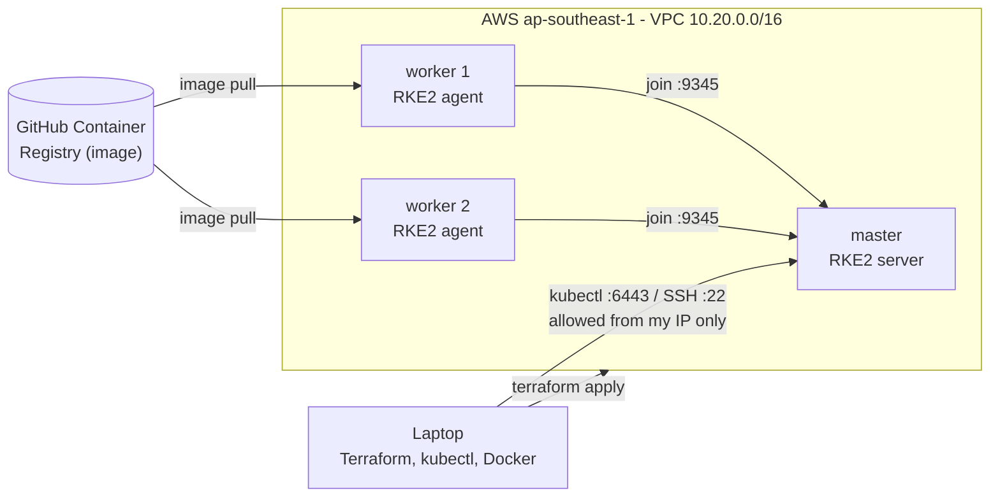
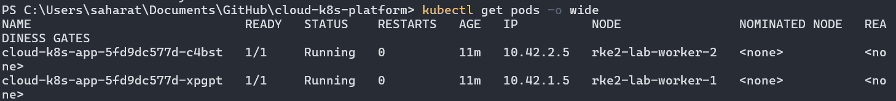
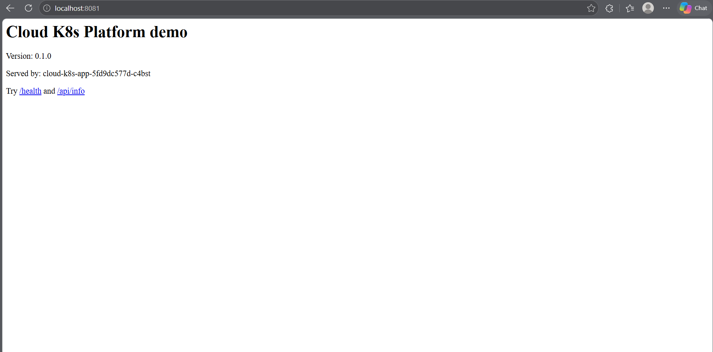
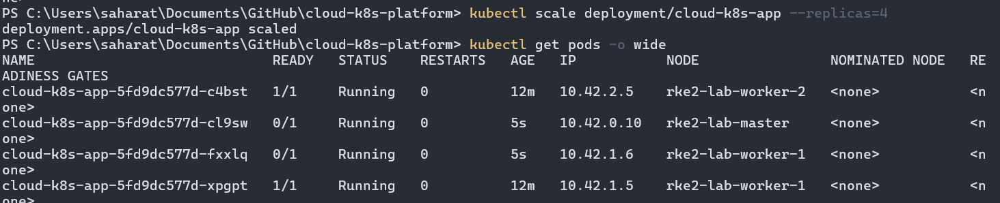
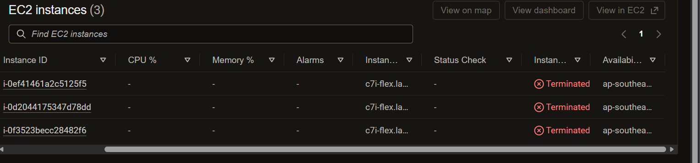

# Cloud K8s Platform: Kubernetes on AWS with Terraform

A small Flask web app, containerised with Docker and run on Kubernetes. The same app is
practised locally on a `kind` cluster and then run on a **3-node RKE2 Kubernetes
cluster on AWS** (built with Terraform, app deployed from GHCR), with all infrastructure written as code (Terraform).

> Status: work in progress. See the [roadmap](#roadmap) for what is done and what is not.

## Architecture



## What it uses

| Area | Tools |
|---|---|
| App | Python 3.12, Flask, gunicorn (`/`, `/health`, `/api/info`) |
| Containers | Docker, Docker Compose, non-root user |
| Kubernetes | `kind` (local), RKE2 (AWS), Deployment, Service, readiness and liveness probes, resource requests and limits |
| Infrastructure as code | Terraform: VPC, subnet, internet gateway, route table, security group, key pair, 3 EC2 instances |
| Cluster bootstrap | cloud-init user data installs RKE2 (1 server + 2 agents joined by a shared token) |

## Repository layout

| Folder | Purpose |
|---|---|
| `app/` | Flask app and Dockerfile |
| `docker-compose.yml` | Run the app locally with one command |
| `k8s/local/` | Manifests for the local `kind` cluster |
| `k8s/aws/` | Manifests for the AWS cluster (image from GHCR) |
| `terraform/rke2/` | AWS infrastructure and RKE2 cluster (`tf.ps1` is a Windows login helper) |
| `terraform/gcp-rke2/` | The same design for Google Cloud (written and planned, not applied) |
| `docs/` | Troubleshooting log |

## Security choices

- SSH, the Kubernetes API (6443), HTTP and HTTPS are open **only to my own IP** (`/32`); node-to-node traffic is allowed only inside the security group.
- EC2 instances require IMDSv2 and use encrypted gp3 disks.
- No long-lived AWS access keys: Terraform runs with short-lived credentials from `aws login`.
- `*.tfvars`, state files, plans and kubeconfig files are git-ignored. Only `example.tfvars` is committed.

## Quick start

### 1. Run locally with Docker

```
docker compose up --build
```
Open http://localhost:8080 (health check: http://localhost:8080/health).

### 2. Run on a local Kubernetes cluster (kind)

```
kind create cluster --name dev
docker build -t cloud-k8s-app:0.1 ./app
kind load docker-image cloud-k8s-app:0.1 --name dev
kubectl apply -f k8s/local/
kubectl port-forward service/cloud-k8s-app 8080:80
```
Open http://localhost:8080. Delete a pod with `kubectl delete pod <name>` and Kubernetes recreates it
to keep `replicas: 2`.

### 3. Build the cluster on AWS

Requires the AWS CLI (logged in with `aws login`), Terraform and an SSH key (`~/.ssh/id_ed25519.pub`).

```
cd terraform/rke2
copy example.tfvars terraform.tfvars   # then set allowed_cidr to <your public IP>/32
terraform init
.\tf.ps1 plan -out=tfplan
.\tf.ps1 apply tfplan
```
Wait about 5 to 10 minutes for RKE2 to install, then fetch the kubeconfig (see the `kubeconfig_hint`
output), set `KUBECONFIG`, and check `kubectl get nodes` (expect 1 control-plane and 2 workers, all `Ready`).

Deploy the app (the image must be pushed to GHCR and set to public first; the **Build and push image**
workflow in the Actions tab can do the push, or do it by hand):

```
docker tag cloud-k8s-app:0.1 ghcr.io/bat-sr/cloud-k8s-app:0.1
docker push ghcr.io/bat-sr/cloud-k8s-app:0.1
kubectl apply -f k8s/aws/
kubectl port-forward service/cloud-k8s-app 8080:80
```

`tf.ps1` exists because Terraform's AWS provider cannot read `aws login` sessions directly; the script
exports short-lived credentials into the process and then runs Terraform.

## Result: running on AWS

Run on 2026-11-26 in `ap-southeast-1`: 3 x `c7i-flex.large`, RKE2 `v1.36.6+rke2r1`. After the demo the whole
environment was removed with `terraform destroy`. The app was reached with `kubectl port-forward`
(local port 8081), not through a public load balancer.

Three nodes, all `Ready` (`kubectl get nodes -o wide`, trimmed):

```
NAME                STATUS   ROLES                AGE   VERSION          INTERNAL-IP   OS-IMAGE             CONTAINER-RUNTIME
rke2-lab-master     Ready    control-plane,etcd   28m   v1.36.6+rke2r1   10.20.1.152   Ubuntu 22.04.5 LTS   containerd://2.3.7-k3s1
rke2-lab-worker-1   Ready    <none>               28m   v1.36.6+rke2r1   10.20.1.33    Ubuntu 22.04.5 LTS   containerd://2.3.7-k3s1
rke2-lab-worker-2   Ready    <none>               28m   v1.36.6+rke2r1   10.20.1.109   Ubuntu 22.04.5 LTS   containerd://2.3.7-k3s1
```

The image was pulled from GHCR and two replicas started on the two workers:



The app answers through the tunnel, and the page shows which pod served it:



Scaling to 4 replicas (`kubectl scale deployment/cloud-k8s-app --replicas=4`) spread the pods over all three nodes.
Full output: [docs/cluster-nodes.txt](docs/cluster-nodes.txt), [docs/cluster-pods.txt](docs/cluster-pods.txt).



Cleanup: after `terraform destroy`, the EC2 console showed all three instances as `Terminated`.



## Cost warning

Three EC2 instances bill while they exist. **Always run `.\tf.ps1 destroy` when you finish**, then check the
EC2 console that nothing is still running.

## Roadmap

- [x] Flask app, Dockerfile, Docker Compose
- [x] Local Kubernetes with `kind` (2 replicas, probes, self-healing)
- [x] Terraform: VPC, security group, 3 EC2 instances
- [x] RKE2 cluster on AWS (1 master + 2 workers, all nodes `Ready`)
- [x] Deploy the app to the AWS cluster (image from GHCR), scale to 4 replicas, then destroy
- [x] CI: GitHub Actions builds and pushes the image to GHCR
- [ ] Monitoring (Prometheus, Grafana)
- [ ] GitOps (ArgoCD)

## Troubleshooting

Problems I hit and how I fixed them are in [docs/TROUBLESHOOTING.md](docs/TROUBLESHOOTING.md).
